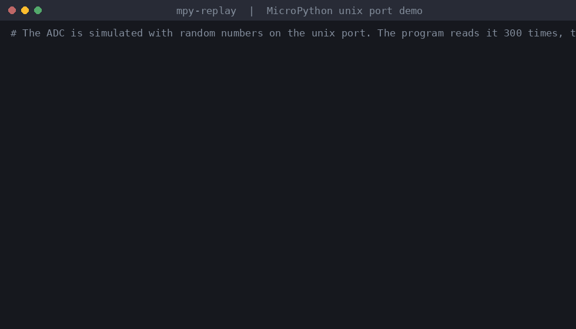

# mpy-replay

**Deterministic record & replay for MicroPython.**
Record the external inputs of a running MicroPython program, then re-run the exact same execution later on a PC, where you can reproduce and inspect it as often as you need.

> **Status: v0.1.0-alpha (prototype).** Record and replay are validated end to end on the MicroPython **unix port**. The STM32 adapter is written but **not yet tested on hardware**. APIs and the log format may change before v1.0.

**Alpha: what it is, and what it is not**

- It **is** a working prototype of deterministic record and replay for MicroPython, validated end to end on the unix port, with tests, a fuzzed log parser and documented limits.
- It is **not** yet a field tool for STM32. It has never run on a real board, and the log starts at `replay.start()` and stops when full (4 KB of backup SRAM holds a few hundred events), so a crash that happens long after the start is not captured. A circular black-box mode is planned.
- Only some inputs are recorded (see section 6). An unrecorded input makes the replay stop with a divergence report instead of silently giving a wrong result.



*Terminal demo made from the real output of the commands shown, on the MicroPython unix port. The ADC is simulated with random numbers; the replay reads the log instead.*

[](https://github.com/lachiheb-ahmed/mpy-replay/actions/workflows/ci.yml)

Copyright (c) 2026 Ahmed ([@lachiheb-ahmed](https://github.com/lachiheb-ahmed)). MIT licensed, see [LICENSE](LICENSE) and [NOTICE](NOTICE).

---

## Contents

1. [Why](#1-why)
2. [How it works](#2-how-it-works)
3. [What is validated today](#3-what-is-validated-today)
4. [Repository layout](#4-repository-layout)
5. [Quick start (unix port)](#5-quick-start-unix-port)
6. [Python API](#6-python-api)
7. [Determinism rules](#7-determinism-rules)
8. [Portability and port support](#8-portability-and-port-support)
9. [Log format](#9-log-format)
10. [Integrating a new port](#10-integrating-a-new-port)
11. [Limitations](#11-limitations)
12. [Roadmap](#12-roadmap)
13. [Authorship, license and citation](#13-authorship-license-and-citation)

---

## What it is for, and what it is not (yet)

**It can help today** (validated on the unix port):

- **Reproducing a bug that depends on a sequence of inputs and on timing.** [examples/field_bug](examples/field_bug) is a serial-frame parser that crashes only when the sender stalls mid-frame. Five independent recordings crashed at five different points; each recording replays to the same state every time, and the final state shows the root cause.
- **Inspecting the reproduced failure.** Statements that add no VM branch, such as `print()`, can be added to the program and the same log still replays, so you can watch the internal state evolve up to the crash.
- **Bugs that depend on `ticks_ms()` values** (timeouts, wrap-around) and on **the order in which scheduled callbacks (soft IRQs) run relative to the main loop**. The callback order is validated with simulated interrupts that use the same scheduler call a real ISR uses.

**Not covered yet:**

- **Replaying modified code.** After a fix that changes control flow, the replay stops with a divergence, because it checks the logical clock. An input-only replay mode, to re-test a fix against recorded inputs, is planned.
- **Long recordings on a board.** 4 KB of backup SRAM holds a few hundred events (about 160 reads of the example above). Streaming and larger backends are planned.
- **Real-time timing.** Events are ordered on a logical clock, not real time: the skew between two pins read one after the other is not stored. Waveform-level signals (DMX, PIO, bit-banged buses), hard IRQ handlers, DMA, memory or GC bugs and performance problems are out of scope.
- **Real hardware.** It has not been run on a board yet.

## 1. Why

Bugs found in the field depend on timing, sensor noise, serial traffic and interrupts that cannot be reproduced on the bench. A stack trace is rarely enough.

`mpy-replay` stores only the **inputs** of the program (a few bytes per event) and can then re-execute the run deterministically, so any crash can be reproduced and inspected as often as needed.

## 2. How it works

```
Execution = f(firmware, Python sources, heap config, input log)
```

If every input and the exact point where it was delivered are known, the VM can be re-run identically.

**Logical clock.** The VM hook `MICROPY_VM_HOOK_LOOP` (in `py/vm.c`, `pending_exception_check`) runs on every VM *branch* (jumps, conditional jumps, loop iterations). `mpy-replay` increments a 64-bit counter there. Wall-clock time is never used to order events.

**Record.** Inputs are logged with the logical clock at which the program received them:

| Input | Where it is captured |
|---|---|
| `time.ticks_ms/us/cpu` | C hook in `extmod/modtime.c` (patched by a script) |
| ADC, Pin, UART, I2C, SPI, random | Python proxies in `replay_io.py` (any port, no C code) |
| Scheduled callbacks (`Pin.irq`, `Timer`, ...) | `@replay_io.irq_handler`, logged when the callback is *delivered* |
| `KeyboardInterrupt` | VM hook, logged when it is delivered (also when it interrupts a recorded read) |
| Checkpoints, marks, last words | `replay.checkpoint()`, `replay.mark()`, `replay.crash()` |

**Replay.** The same program runs with the log loaded. Every input function returns the logged value instead of touching hardware, and asynchronous events are injected when the logical clock reaches their recorded value. Before returning anything, the engine checks that the *kind* of input and the *logical clock* match the log. Any mismatch stops the run with a **divergence** report (reason, clock, expected and logged event).

**Frozen clock during reads.** While a recorded hardware read runs (record mode only), the clock is frozen and the scheduler is locked. Otherwise the code that exists only in record mode would shift the clock and replay would diverge.

## 3. What is validated today

| Check | Result |
|---|---|
| Core unit tests (CRC vectors, codecs, record, replay, divergence, truncation, storage-full), AddressSanitizer + UBSan | pass |
| End-to-end on the unix port, CPU-bound program (clock, UART proxy, RNG, checkpoints, Ctrl+C at a random moment) | pass, 6 of 6 runs: same loop count, same program state, same final logical clock, crash reproduced |
| End-to-end, I/O-bound program (Ctrl+C that lands *inside* a recorded read) | pass |
| Build of the user module with MicroPython's own `-Wall -Werror` flags | pass |
| Firmware build with the module for STM32 (`NUCLEO_F429ZI`, `PYBV11` F405, `NUCLEO_F767ZI`): compile and link, footprint about 4.8 KB flash and 1 KB RAM | pass |
| STM32 backup-SRAM adapter **running on hardware** | **not tested** |
| Firmware hash check (same, different, overridden, unset); malformed hash rejected at build time | pass |
| Regression tests for an external code review (`mark` verification, unconsumed events, `read()` bounds, outputs during replay, storage erase order) | pass |
| A full log does not kill the application; the real crash is always the exception reported; `replay_io` proxies verify the whole request (I2C address/memory address/size, SPI size/byte, UART size); replay image freed on every exit path | pass |
| `replay_io.run()` surfaces replay errors on a normal ending; malformed firmware hash stops the build (6 build checks) | pass |
| CI workflow (`.github/workflows/ci.yml`: core tests, unix end to end, STM32 builds) | written, **not yet run on GitHub** |
| IRQ end to end (SIGUSR1 delivered through `mp_sched_schedule` like an ISR, 3 of 3 runs) | pass |
| CMake build (rp2, esp32) | **not tested** |
| Bit-exact heap replay (Tier B) | **not implemented** |

Tested against MicroPython master (commit `9e10c3e`, unix port, `standard` variant).

## 4. Performance and FAQ

The hook adds a 64-bit increment and one test per VM branch. Measured on the unix port (shared single core, so treat as indicative): about +1% to +13% on realistic code, up to about +20% on a branch-only loop, and recording adds roughly 5-10% on top. On Cortex-M the fast path is 10 instructions. Details, method and caveats are in [docs/BENCHMARK.md](docs/BENCHMARK.md). Questions you are likely to ask (GC, asyncio, floats, prior art, security of logs, upstreaming) are answered in [docs/FAQ.md](docs/FAQ.md). How many events fit in the log, and what the tool is not for (waveform-level capture, real-time skew), is in [docs/SIZING.md](docs/SIZING.md).

## 4b. Repository layout

```
replay/core/           portable C99 core (clock, codecs, recorder, reader, replay engine)
replay/ports/unix/     file-backed storage adapter (record on a PC, tests)
replay/ports/stm32/    backup-SRAM adapter (STM32F4/F7, untested)
usermod/               MicroPython glue: `replay` C module, VM hook, replay_io.py proxies
scripts/               apply_time_hook.py (patches extmod/modtime.c)
tools/                 mrl_dump: inspect a .mrl log
tests/                 core unit tests and end-to-end scripts
```

## 5. Quick start (unix port)

```bash
git clone https://github.com/micropython/micropython && cd micropython
make -C mpy-cross && make -C ports/unix submodules

# 1. route time.ticks_* through the recorder (revert with --revert)
python3 /path/to/mpy-replay/scripts/apply_time_hook.py .

# 2. record build and replay build
make -C ports/unix VARIANT=standard MICROPY_PY_SSL=0 MICROPY_PY_BTREE=0 MICROPY_PY_FFI=0 \
     USER_C_MODULES=/path/to/mpy-replay MPY_REPLAY_PORT=unix \
     MPY_REPLAY_FW_HASH=$(git rev-parse HEAD) BUILD=build-rec
make -C ports/unix VARIANT=standard MICROPY_PY_SSL=0 MICROPY_PY_BTREE=0 MICROPY_PY_FFI=0 \
     USER_C_MODULES=/path/to/mpy-replay MPY_REPLAY_PORT=unix MPY_REPLAY_MODE=1 MPY_REPLAY_FW_HASH=$(git rev-parse HEAD) BUILD=build-replay \
     CFLAGS_EXTRA='-DMICROPY_FLOAT_IMPL=MICROPY_FLOAT_IMPL_FLOAT'   # match an STM32 recording (single-precision floats)

# 3. record (replay_io.py must be importable)
export MICROPYPATH=/path/to/mpy-replay/usermod
MRL_LOG=run.mrl ports/unix/build-rec/micropython app.py      # Ctrl+C or crash ends it

# 4. inspect, then replay
make -C /path/to/mpy-replay tools/mrl_dump && /path/to/mpy-replay/tools/mrl_dump run.mrl
MRL_REPLAY_LOG=run.mrl ports/unix/build-replay/micropython app.py
```

Step-by-step instructions for an STM32 board are in [docs/BOARD_TEST.md](docs/BOARD_TEST.md).

`MICROPY_PY_SSL=0 MICROPY_PY_BTREE=0` only make the build much faster. **`MICROPY_PY_FFI=0` matters:** without it the unix port needs the libffi headers (`libffi-dev` and `pkg-config` on Debian/Ubuntu), and on a machine that lacks them the build stops at `modffi.c: fatal error: ffi.h: No such file or directory` / `qstr.i.last ... Error 1`. The module uses none of these features.

A complete runnable example, including the automated comparison of a recording and its replay, is in `tests/e2e/` (`run_e2e.sh`).

Minimal program:

```python
import replay, replay_io, machine

replay.start()                                   # first statement of the program

adc = replay_io.ADC(machine.ADC(26), uid=0)

def main():
    while True:
        v = adc.read_u16()                       # recorded / replayed
        ...

replay_io.run(main)                              # logs the crash text, then re-raises
```

Environment variables (unix adapter): `MRL_LOG`, `MRL_CAPACITY` (bytes, default 16 MiB), `MRL_REPLAY_LOG`, `MRL_STRICT_HEAP=1`.

## 6. Python API

`replay` (C module):

| Function | Description |
|---|---|
| `start()` | Begin recording (erases the previous log). In a replay build, load `$MRL_REPLAY_LOG` and begin replaying. |
| `stop([partial])` | Flush and stop. Raises `RuntimeError` if the log was truncated (storage full). In a replay it raises if recorded events were not consumed, unless `partial` is true. |
| `mode()` | `replay.OFF`, `replay.RECORD` or `replay.REPLAY` |
| `clock()` | Current logical clock |
| `mark(text)` | Named synchronization point; the text must match the recording, otherwise the replay diverges |
| `checkpoint([value])` | With a value: application checkpoint, compared during replay. Without: CRC of the GC heap, compared only with `MRL_STRICT_HEAP=1` (bit-exact targets) |
| `crash(text)` | Log the last words. During replay returns `True` if the crash matches the recording |
| `has_log()` | Inspect the log currently in storage: `(bytes, events, last_lclk, crash_text)` or `None` |
| `read(offset, n)` | Read raw log bytes (for export after a reset) |
| `ticks_ms()`, `ticks_us()` | Recorded clocks for code that bypasses `time` |
| `about()` | Version and copyright string |

`replay_io` (pure Python): `ADC`, `Pin`, `UART`, `I2C`, `SPI` proxies, `urandom(n)`, `irq_handler(id, arg)`, `output(fn, *args)`, `run(fn)`.

**Outputs.** `Pin.value(x)` and `replay_io.output(fn, *args)` run the hardware action while recording and **skip it while replaying**, so a replay never drives a relay or a bus. Outputs you do not route through them are executed during replay.

## 7. Determinism rules

Replay is exact only if these hold:

1. **Same sources.** Same MicroPython revision, frozen modules and application code. Pass the same `MPY_REPLAY_FW_HASH` (40 hex characters, for example `git rev-parse HEAD` of your tree) to the recording build and the replay build. A replay build refuses a log with a different hash. Set `MRL_IGNORE_FW_HASH=1` to override, or build without a hash to skip the check.
2. **Start early.** Call `replay.start()` before the first logged input. The logical clock restarts at 0 there, so code that ran before it (boot.py, imports) may differ between the board and the replay host. Inputs read before it are not logged.
3. **Do not branch on the mode.** The logical clock counts VM branches. Python code that runs only in record mode, or only in replay mode (`if replay.mode() == ...`), shifts the clock and causes a divergence. Mode-dependent work belongs in C (`replay._io` does this correctly).
4. **All inputs go through the recorder.** Any unrecorded source (a peripheral read without a proxy, `time.time()`, `machine.rng()`) is non-deterministic.
5. **Single VM thread.** Build without `_thread`.
6. **No `id()`-dependent logic** unless replaying on a bit-exact target (not implemented yet).
7. **Hard IRQ handlers must not change Python-visible state.** Use `micropython.schedule` and `@replay_io.irq_handler`. The `arg` given to the decorator must be what the real source passes to the handler, because that is what the replay passes.
8. **Route outputs through the recorder** (`Pin.value(x)`, `replay_io.output`) if replay must not touch the hardware.
9. **The replay host must match the board's numbers.** STM32 builds use single-precision floats, the unix port defaults to double (`0.1+0.2` prints `0.3` on STM32 and `0.30000000000000004` on unix). Build the replay binary with `CFLAGS_EXTRA='-DMICROPY_FLOAT_IMPL=MICROPY_FLOAT_IMPL_FLOAT'` when replaying a recording from STM32 (verified to build and give single-precision results). Word size also differs (31-bit small ints on a 32-bit MCU, 63-bit on a 64-bit PC; `MICROPY_FORCE_32BIT` no longer exists in current MicroPython), so `sys.maxsize`, `id()` and the iteration order of `set` may differ. Avoid logic that depends on them.
10. **Seed `random` from the recorder.** The `random` module is seeded from the hardware RNG at import time, which is not recorded. Call `replay_io.seed_random()` right after `replay.start()`, or seed it yourself with a recorded value.

## 8. Portability and port support

The design has three layers so that the same core serves every port:

| Layer | Location | Portable |
|---|---|---|
| Core | `replay/core/` | Yes (pure C99) |
| MicroPython glue | `usermod/` | Yes (uses only public MicroPython APIs and one VM hook) |
| Port adapter | `replay/ports/<port>/` | No: storage and board identification, about 60 lines |

Peripheral reads use Python proxies, so no peripheral driver is modified.

**Record and replay are separate choices:** a log recorded on one port can be replayed on another, provided the Python-visible behavior is the same.

| Replay target | Determinism | Status |
|---|---|---|
| Tier A: unix port | Same Python-visible behavior if the host matches the board's numeric configuration (see rule 9); heap addresses and `id()` differ | validated |
| Tier B: QEMU Cortex-M (`ports/qemu`) | Bit-exact heap for ARM recordings | not implemented |
| Tier C: same MCU in replay mode | Real clocks and CPU speed | not implemented |

| Port | Record | Notes |
|---|---|---|
| unix | validated | file storage |
| stm32 | builds for F405/F429/F767; not run on hardware yet | STM32F4/F7, backup SRAM (4 KB), `MRL_FLUSH_EVERY_EVENT=1` set automatically |
| rp2, esp32, nrf, samd, mimxrt | planned | need a storage adapter; CMake file provided, untested |

On some ports (for example unix) `KeyboardInterrupt` is raised from the signal handler at an arbitrary instruction. `replay.start()` installs a handler that only schedules it, so it is delivered on a VM branch and can be logged.

## 9. Log format

Little endian, append only, extension `.mrl`.

**Header (64 bytes)**

| Offset | Size | Field |
|---|---|---|
| 0 | 4 | Magic `MRL1` |
| 4 | 2 | Format version (1) |
| 6 | 2 | Flags (reserved, 0) |
| 8 | 20 | Firmware git hash |
| 28 | 4 | Heap size |
| 32 | 8 | RNG seed (reserved, 0) |
| 40 | 4 | Board ID |
| 44 | 16 | Reserved (0) |
| 60 | 4 | CRC32 of bytes 0..59 |

**Record**

```
varint  lclk delta      LEB128, logical clock since the previous event
u8      type
u8      len             0..255
u8[]    payload
u16     crc16           CRC-16/CCITT-FALSE over the record, seeded with the header CRC32 (low 16 bits)
```

The seed makes records left over from an older, longer log invalid. The first record that fails its CRC marks the end of the valid log, which also covers a write interrupted by power loss.

| Type | Name | Payload |
|---|---|---|
| 0x01 | TICKS_MS | u64 |
| 0x02..0x07 | ADC, GPIO, UART_RX, I2C_RD, SPI_RD, RNG | proxy defined (first byte is the device id) |
| 0x08 | IRQ_SCHED | u8 handler id |
| 0x09 | EXC_ASYNC | u8 kind: 0 = KeyboardInterrupt at a branch, 1 = other, 2 = KeyboardInterrupt inside a read |
| 0x0A | CHECKPOINT | u8 kind (0 heap, 1 user), u32 value |
| 0x0B | MARK | text |
| 0x0C, 0x0D | TICKS_US, TICKS_CPU | u64 |
| 0xFF | CRASH | text |

**Storage model.** Events are staged in a RAM buffer (`MRL_STAGE_SIZE`, 512 B) and written to storage when it fills, or on every event with `MRL_FLUSH_EVERY_EVENT=1`. When storage is full, recording stops cleanly and `replay.stop()` reports the truncation; the log stays valid up to that point. Replay needs the log from the start of the run.

## 10. Integrating a new port

1. Implement `replay/core/replay_port.h` for the port (storage init/reset/read/write/flush, board ID, heap size). `storage_init` must preserve existing contents.
2. Build with `USER_C_MODULES` (make) or `usermod/micropython.cmake` (CMake) and `MPY_REPLAY_PORT=<port>`.
3. Run `scripts/apply_time_hook.py` on the MicroPython tree.
4. Make sure the port does not already define `MICROPY_VM_HOOK_LOOP`, and builds without threads.
5. Run the end-to-end test against the new port.

## 11. Limitations

- **Hard IRQ handlers** run inside the interrupt and cannot be placed on the logical clock.
- **Callbacks recorded during a blocking C call** (for example a long `time.sleep`) are delivered at the next VM branch on replay. They are counted (`late_async`) and not treated as a divergence; later checks still catch any real difference.
- **An exception other than `KeyboardInterrupt` raised by a recorded read or output** is not recorded.
- **Backup SRAM retention** is only designed for a plain reset in v0.1. The backup regulator is enabled for VBAT retention and initialization fails if the HAL reports it is not ready (build with `-DMRL_STM32_REQUIRE_BKUP_REG=0` to accept reset-only retention), but retention across power loss is not verified on hardware.
- **Reads are bounded by one record**: 253 bytes per UART read, 252 per SPI read, 248 per I2C read. Address, size and (for SPI) the written byte are logged with the data and verified on replay.
- **A full log never stops the application.** Recording simply ends at that point; `replay.stop()` reports the truncation, and a replay of that log stops with `end of log` where the recording ended.
- **The hash identifies a source revision, not a binary.** It cannot detect a change of compiler flags or an application edit that you did not reflect in the hash.
- **A recorded read cannot be interrupted** by IRQ callbacks while it runs (they run right after it).
- **Heap CRC checkpoints** are meaningful only on a bit-exact target.
- **Threads** and a second core running Python are not supported.
- **Storage size** bounds the recording length. On STM32 backup SRAM (4 KB) this is a short flight recorder, not a long session log.

## 12. Roadmap

- [x] Enforce the firmware hash
- [ ] Validate the STM32 adapter on hardware (it already compiles and links for three boards)
- [ ] Flash and external memory (FRAM/SD) backends; ring-buffer mode with periodic state snapshots
- [ ] Tier B: QEMU bit-exact replay and heap checkpoints
- [ ] Tier C: replay on the target MCU from a log held in flash
- [ ] Record exceptions raised by reads
- [ ] CI that builds and runs the end-to-end test on every commit
- [ ] Test with `asyncio` and `machine.Timer` workloads (not yet exercised)
- [ ] Measure the hook cost on real STM32 hardware
- [ ] Stable log format (v1.0)

Contributions: see [CONTRIBUTING.md](CONTRIBUTING.md).

## 13. Authorship, license and citation

Original design and implementation: **Ahmed ([@lachiheb-ahmed](https://github.com/lachiheb-ahmed))**, 2026.

Released under the MIT license. Anyone may use and modify the code, but the copyright notice in [LICENSE](LICENSE) and in every source file must be kept. Firmware images that include the module carry the provenance string returned by `replay.about()`.

If you use `mpy-replay` in academic or industrial work, please cite the repository and its release tag.

This project builds on [MicroPython](https://github.com/micropython/micropython) (MIT).
